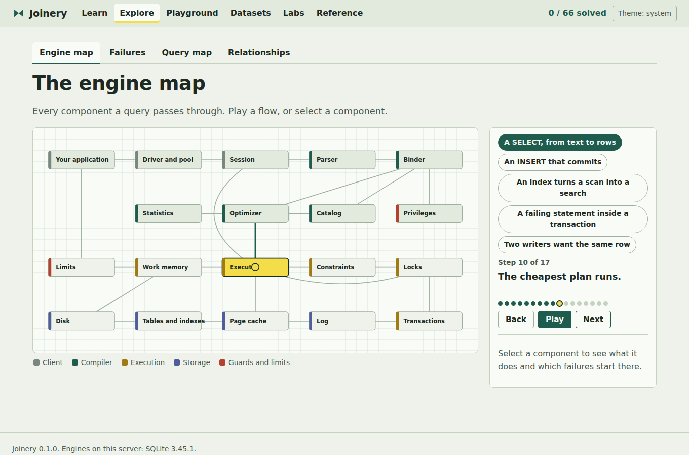
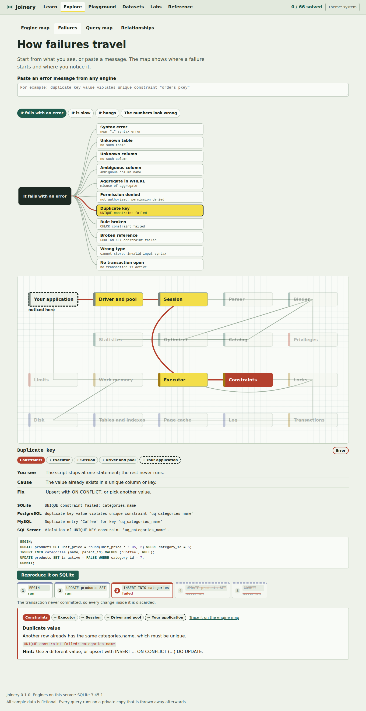
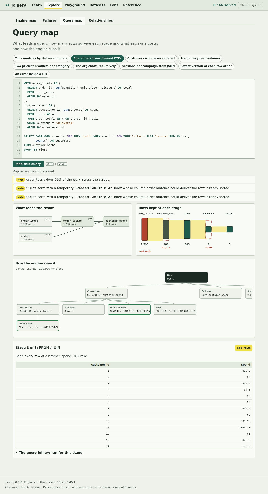
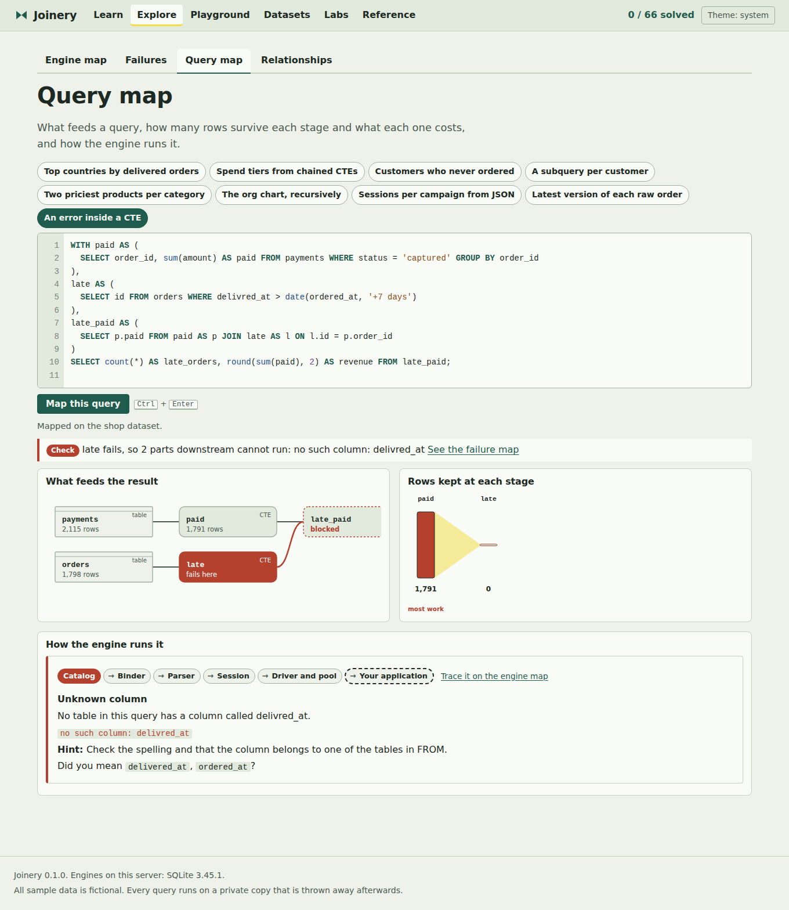
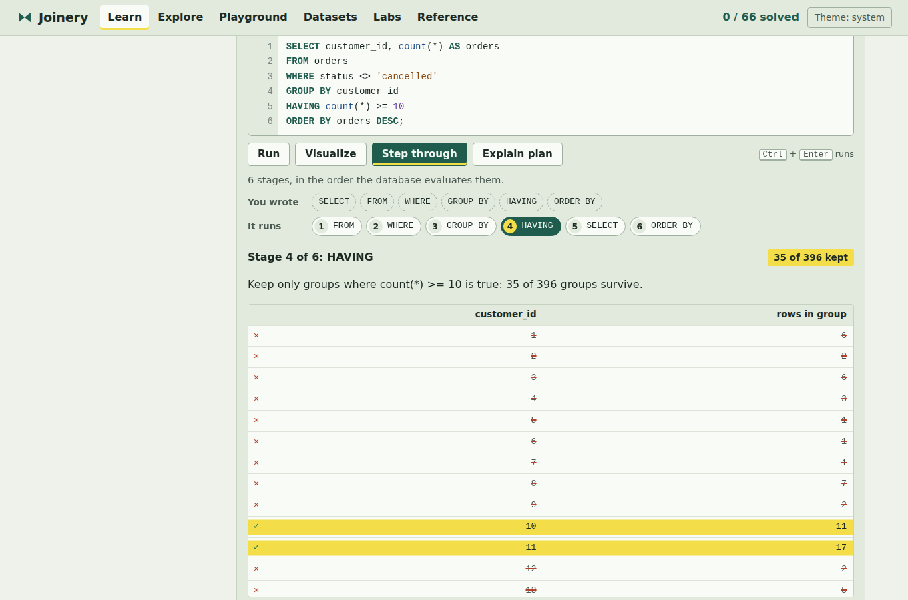
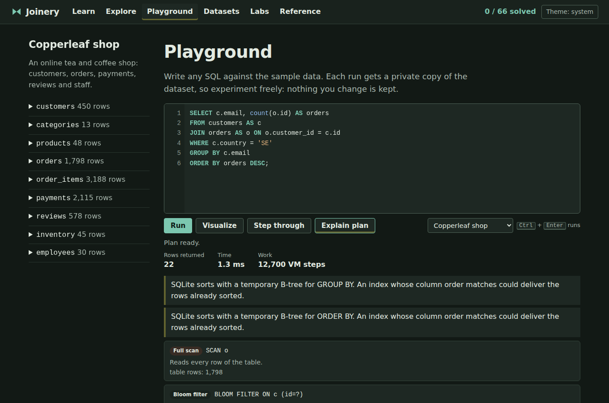
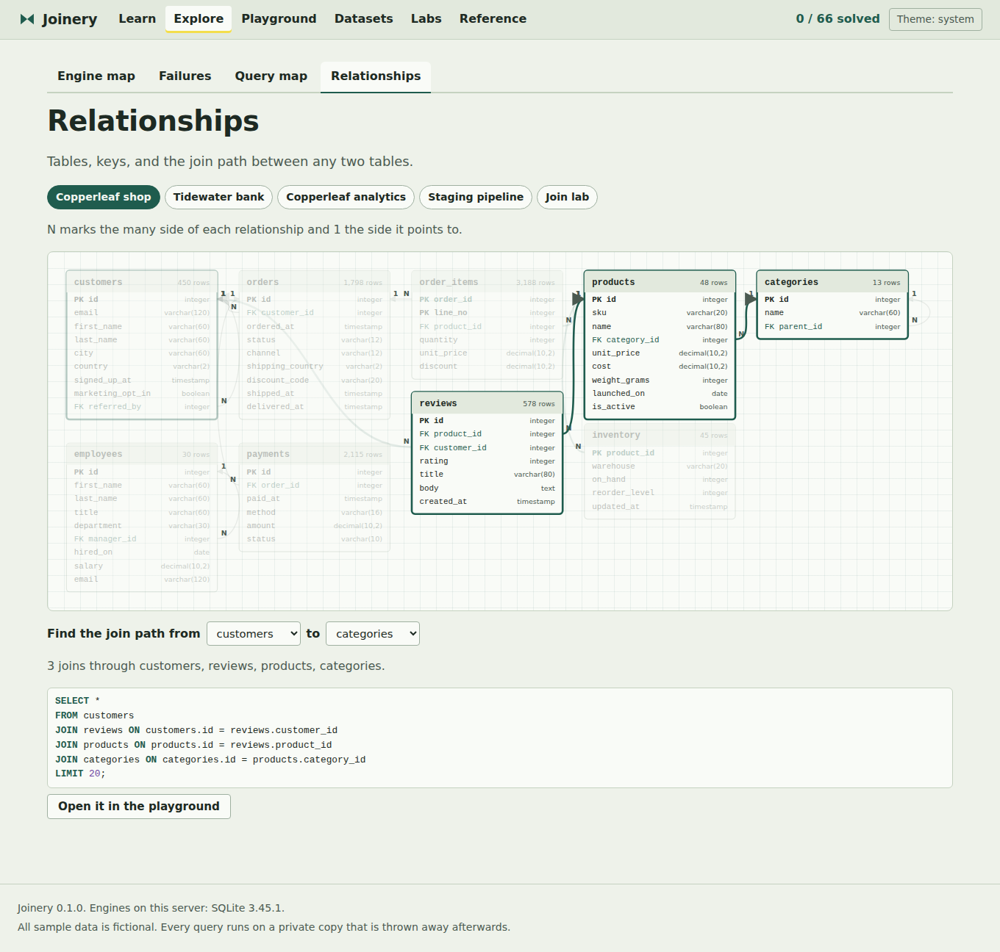
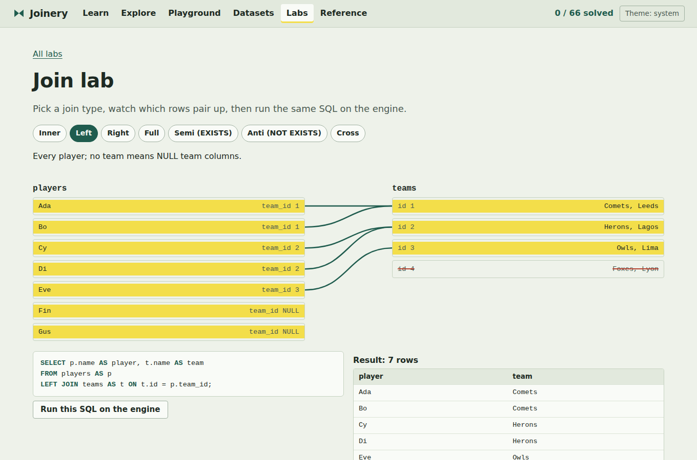
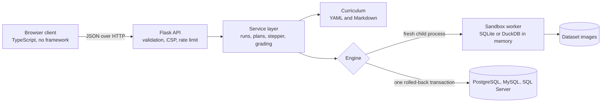
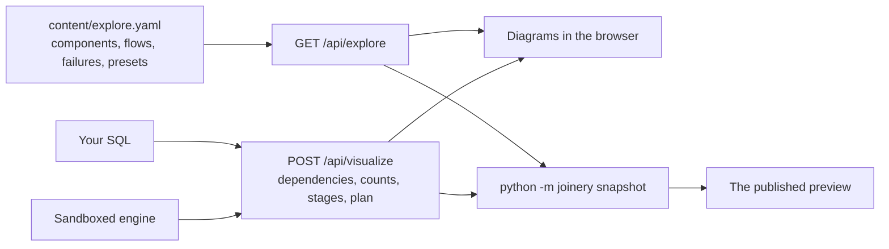

# Joinery

**SQL you can see.** Joinery is an interactive SQL course and playground that draws what the database does with your query, so you watch it run instead of reading about it.

[](https://aboualyxcode.github.io/joinery/)
[](https://github.com/aboualyXcode/joinery/actions/workflows/ci.yml)
[](https://github.com/aboualyXcode/joinery/actions/workflows/engines.yml)


The examples follow Copperleaf, a fictional tea and coffee shop, through its orders, its clickstream and its data pipeline, next to the accounts of a fictional bank. Every query you write runs on a sandboxed copy of one of those databases, and Joinery draws what happened: **what feeds the result**, from tables through CTEs and subqueries with the rows at each, **how many rows survive each logical stage** and which stage does **the most work**, and the **physical plan** as a tree. An **engine map** of 19 components plays a query from your driver to the disk, and **33 failures**, from a typo to a deadlock, travel across it **from where they start to where you notice them**.

Behind the diagrams are 26 lessons and 66 exercises graded against **the engine's real result**, on SQLite, with side-by-side versions for PostgreSQL, MySQL, SQL Server and DuckDB wherever the engines differ.

## [▶ Open Joinery in your browser](https://aboualyxcode.github.io/joinery/)

The published copy replays results recorded from the real engine, so it runs the course's own queries. To write your own SQL and have your answers checked, [run Joinery yourself](#quick-start) with one command.

| | |
|---|---|
|  |  |
| A `SELECT` travels the engine map one component at a time. | A duplicate key starts in Constraints and surfaces in your application. The script stops there and its transaction never commits. |
|  |  |
| Chained CTEs on the query map: what feeds the result, the rows each stage keeps, and the plan. | A misspelled column fails inside one CTE and blocks everything that depends on it. |

## Contents

- [Quick start](#quick-start)
- [See it in diagrams](#see-it-in-diagrams)
- [What is inside](#what-is-inside)
- [The course](#the-course)
- [Engines and dialects](#engines-and-dialects)
- [How it works](#how-it-works)
- [Security](#security)
- [Development](#development)
- [Extending Joinery](#extending-joinery)
- [Project structure](#project-structure)
- [What has been verified](#what-has-been-verified)
- [Credits](#credits)

## Quick start

**With Docker** (nothing else to install):

```sh
git clone https://github.com/aboualyXcode/joinery.git
cd joinery
docker compose up --build
```

Open <http://localhost:8000>. To add PostgreSQL 18, MySQL 9.7 and SQL Server 2025 as extra engines (experimental), run `docker compose --profile engines up --build` and open <http://localhost:8001>.

**Locally**, with Python 3.12+ and Node.js 22.18+ on Linux or macOS:

```sh
python3 -m venv .venv && . .venv/bin/activate
make setup      # Python and Node dev dependencies, plus Chromium for browser tests
make dev        # builds the client and datasets, serves http://127.0.0.1:8000
```

Windows users can run Joinery through Docker or WSL 2: the sandbox relies on POSIX resource limits.

## See it in diagrams

| Diagram | What it shows | Where you find it |
|---|---|---|
| **Engine map** | 19 components from your driver to the disk, coloured by layer. Five flows play step by step: a `SELECT`, an `INSERT` that commits, an index lookup, a failing statement inside a transaction, and two writers after one row. Select a component to see what it does and which failures start there. | Explore, and the lessons on `SELECT`, `INSERT`, indexes and transactions |
| **Failure map** | 33 failures: 15 errors, 6 hangs, 6 slow queries and 6 wrong results. Each starts at one component (red pencil), passes through others (highlighted) and is noticed at another (ringed), with knock-on effects dashed. Start from a symptom, or paste a message from SQLite, PostgreSQL, MySQL, SQL Server or DuckDB. 16 reproduce live; 10 run the slow and fast, or wrong and right, query side by side. | Explore, troubleshooting, constraints and optimization |
| **Query map** | Behind **Visualize** in every editor. Bottlenecks first, then what feeds the result (correlated subqueries and recursion marked, a failure shown where it starts and everything downstream blocked), the rows kept at each logical stage shaded by the work it costs, and the plan as a tree. Click any node or stage for its SQL and rows. | Explore, every example, the playground |
| **Statement timeline** | For a script that fails: the statement that failed, the ones that never ran, and whether the transaction committed. | Every run that fails part-way |
| **Where it starts** | Every error names the component it comes from, as a path to your application, and links to its trace on the map. | Every error |
| **Relationships** | Tables and keys with N and 1 on each link. Pick two tables to light up the foreign-key path between them and get the joins written out. | Explore, Datasets, schema design |

Everything on the maps is data in [`content/explore.yaml`](content/explore.yaml), checked when it loads: no component overlaps another, no connection runs through one, every path and flow follows the wiring, every live demo reproduces the message its entry matches, and every sample message matches its own entry. [docs/diagrams.md](docs/diagrams.md) explains how to add a component, a flow or a failure.

## What is inside

- **A course of 26 lessons** in six modules, from `SELECT` to ELT pipelines, with 126 runnable examples and 66 graded exercises. 24 sections carry a diagram.
- **Explore**: the engine map, the failure map, the query map and the relationship explorer described above.
- **A playground** with a highlighting editor, five sample datasets, a schema browser and keyboard shortcuts (<kbd>Ctrl</kbd>+<kbd>Enter</kbd> runs, <kbd>Ctrl</kbd>+<kbd>Shift</kbd>+<kbd>Enter</kbd> steps through).
- **The stepper**: a query split into its logical stages (`WITH`, `FROM`/`JOIN`, `WHERE`, `GROUP BY`, `HAVING`, `SELECT`, `DISTINCT`, `ORDER BY`, `LIMIT`), each executed for real. Filter stages highlight kept rows and strike through removed ones. `UPDATE` and `DELETE` statements preview the rows they will touch.
- **Execution plans** as a tree, with index advice, work counts, and SQLite's bytecode program annotated opcode by opcode, loops marked.
- **Errors explained**: plain-language causes, likely fixes and "did you mean" suggestions you can apply with one click, plus lint warnings for traps such as `= NULL`, `NOT IN` with NULLs, comma joins and index-defeating predicates.
- **Grading that teaches**: results are compared with tolerance and order rules, and the feedback says whether you have too many rows, the wrong columns, wrong values or the wrong order. Performance exercises also check that the plan uses an index.
- **Labs**: a join lab that draws which rows pair up for every join type, an isolation simulator for dirty reads, lost updates, phantoms and write skew, an index lab that compares plans with and without the index you design, and a query journey from parser to storage.
- **Downloadable scripts** that load each dataset into SQLite, PostgreSQL, MySQL, SQL Server or DuckDB, and **a dialect reference** of 24 features across five engines, reviewed against the releases current in October 2026.

| | |
|---|---|
|  |  |
|  |  |

## The course

| Module | Lessons |
|---|---|
| 1. Foundations | Selecting columns and computing values, Filtering rows with WHERE, Sorting and paging, Data types, dates and text, Aggregating with GROUP BY and HAVING |
| 2. Combining data | Joins, Subqueries and EXISTS, Common table expressions, Set operations, Window functions |
| 3. Changing data and schema | Inserting, updating and deleting, Designing schemas, Constraints and data integrity, Indexes, Transactions and isolation |
| 4. Advanced analytics | Recursive queries, Working with JSON, Time series, Funnels, experiments, cohorts and pivots |
| 5. Performance | How a database runs a query, Reading execution plans, Optimizing queries |
| 6. Production SQL | ELT pipelines and data quality, SQL security, Testing, migrations and deployment, Troubleshooting |

Each lesson cites the official documentation and ends with notes on how PostgreSQL, MySQL, SQL Server and DuckDB differ. Examples carry per-dialect variants where the syntax differs.

The five datasets are fictional and generated deterministically, about 57,000 rows in total:

| Dataset | Domain | Highlights |
|---|---|---|
| `shop` | An online tea and coffee shop | Orders, line items with historical prices, payments and refunds, reviews, stock, a category tree, an org chart |
| `bank` | A retail bank | A year of signed transactions, transfers between accounts, weekday-only FX rates for as-of joins, suspicious bursts |
| `analytics` | Product analytics | Sessions of clickstream events with JSON properties, campaigns, an A/B test, sensor readings with gaps |
| `pipeline` | Data engineering | Raw text exports with every kind of mess, a type 2 customer dimension, a fact table, a run log with watermarks |
| `joinlab` | Join practice | Four teams and seven players, built so every join type returns something different |

## Engines and dialects

| Engine | Status | How it runs |
|---|---|---|
| SQLite 3.45+ | Verified: the full test suite and every lesson run on it | Process sandbox, private in-memory copy per run |
| DuckDB 1.5 | Experimental, validated by the engines workflow | Same process sandbox, external access disabled and configuration locked |
| PostgreSQL 18 | Experimental, validated by the engines workflow | Low-privilege role, one transaction per run, always rolled back |
| MySQL 8.4 and 9.7 LTS | Experimental, validated by the engines workflow | As above; DDL is limited to temporary tables because MySQL commits DDL implicitly |
| SQL Server 2025 | Experimental, validated by the engines workflow | As above, using Microsoft's `mssql-python` driver |

SQLite needs nothing extra and is always on. The others are enabled by installing their driver (DuckDB) or setting a connection string (the server engines). Lessons and grading run on SQLite; the other engines run the examples' dialect variants. See [docs/engines.md](docs/engines.md).

## How it works



The browser never talks to a database. It sends SQL to the API, which hands each run to an engine. For SQLite and DuckDB that means a brand-new, resource-limited Python process that loads a pristine copy of the dataset, runs the statements and exits. The stepper, plans and grading are built from the same primitive: batches of statements executed by an engine. Details are in [docs/architecture.md](docs/architecture.md).

### Where the diagrams get their data



The dependency graph is read from the statement's tokens: the tables, CTEs, derived tables and scalar, `IN` and `EXISTS` subqueries it reads, with correlated subqueries and recursive CTEs flagged. Each node is then counted in its own batch that carries only the CTEs it needs, so when one fails Joinery knows exactly which node broke and marks everything downstream of it as blocked.

## Security

Submitted SQL is treated as untrusted code. Each SQLite run executes in a separate interpreter started in isolated mode with an empty environment. Before any SQL runs, the worker caps CPU time, memory, file size (zero, so nothing can be written to disk), open files and process creation. It then puts SQLite in defensive mode with lowered run-time limits, a heap limit, a database size cap and a wall-clock deadline. An authorizer refuses `ATTACH`, extension loading and every `PRAGMA` outside a read-only allowlist. The HTTP layer adds a strict Content Security Policy, request size limits, input validation and per-client rate limiting. The test suite attempts each escape: attaching files, `VACUUM INTO` writes, dangerous pragmas, extension loading, runaway recursion, huge allocations and database growth. Read [docs/security.md](docs/security.md) for the threat model and [SECURITY.md](SECURITY.md) to report a vulnerability.

## Development

| Command | What it does |
|---|---|
| `make setup` | Install Python and Node dev dependencies and the Playwright Chromium browser |
| `make dev` | Build the client and datasets, then serve with auto-reload |
| `make test` | Python unit, integration and security tests, plus TypeScript unit tests |
| `make validate` | Run every lesson example and exercise against SQLite |
| `make e2e` | Browser tests in Chromium |
| `make lint` | `ruff` and the TypeScript type check |
| `make audit` | `pip-audit` and `npm audit` |
| `make check` | Everything CI runs except the browser tests |
| `npm run watch` | Rebuild the client on every change |

`python -m joinery --help` lists the command line: `serve`, `build-datasets`, `export`, `validate`, `provision` and `doctor`. Testing is described in [docs/testing.md](docs/testing.md), configuration in [docs/configuration.md](docs/configuration.md), and deployment in [docs/deployment.md](docs/deployment.md).

### The published preview

```sh
make site                     # npm run build:static, then python -m joinery snapshot
JOINERY_STATIC_SITE=web/site python -m unittest tests.e2e.test_static
```

`web/site` is the client built with relative URLs plus about 700 recorded responses (5 MiB): every lesson example, failure demo, comparison, query-map preset and lab preset. The [Pages workflow](.github/workflows/pages.yml) builds, records, smoke-tests and deploys it on every push to `main`; turn it on once under **Settings → Pages → Source: GitHub Actions**.

## Extending Joinery

- [Writing lessons and exercises](docs/authoring-lessons.md): YAML format, check modes, plan checks, widgets and dialect variants.
- [Adding a dataset](docs/adding-datasets.md): deterministic generators, ERD layout and exports.
- [Adding an engine or dialect](docs/adding-dialects.md): the engine interface, the statement guard and provisioning.
- [The HTTP API](docs/api.md): every endpoint with examples.

## Project structure

```text
joinery/            Python package: API, service layer, engines, sandbox, datasets, SQL tools
  sandbox/          worker.py (the isolated process) and runner.py (spawns and supervises it)
  engines/          SQLite and DuckDB (sandboxed), PostgreSQL, MySQL and SQL Server (server engines)
  sqltools/         tokenizer, splitter, stepper, dependency graphs, plan analysis, errors, lint rules
  datasets/         schema model, generators, image builder and dialect DDL export
  content/          curriculum loader and validator, and the Explore data loader
  snapshot.py       records API responses for the published preview
content/            curriculum.yaml, 26 lessons, dialects.yaml and explore.yaml
web/                TypeScript client, stylesheet and unit tests
  src/components/   enginemap, failures, queryflow, timeline, erd and the other diagrams
tests/              Python tests; tests/e2e drives the client and the static preview in Chromium
docs/               architecture, diagrams, security, engines, testing, deployment and authoring guides
```

The full annotated tree is in [docs/project-structure.md](docs/project-structure.md).

## What has been verified

- 152 Python tests, curriculum validation (126 examples and 66 exercises on SQLite), the TypeScript type check, 17 Node unit tests, the production and static builds, 18 Chromium browser tests and 3 tests of the static preview served from a subpath all pass on Python 3.12, SQLite 3.45.1 and Node.js 22.
- Every live failure demo reproduces, on the real engine, the message its entry matches, and the map's geometry and wiring are checked on load.
- DuckDB, PostgreSQL, MySQL and SQL Server support is implemented and unit-tested with a fake driver. It is validated against real servers by the engines workflow, which needs a GitHub runner because those servers were not available where this project was built. Treat those engines as experimental until that workflow is green.
- The Docker image, Compose stack and Pages deployment follow the documented practices and are exercised by CI, but have not run outside it yet.

## Credits

Created by [Mahmoud Aboualy](https://github.com/aboualyXcode).

Typefaces: Atkinson Hyperlegible Next and Atkinson Hyperlegible Mono by the Braille Institute, loaded from Google Fonts with system fonts as the fallback (set `JOINERY_WEB_FONTS=false` to stay fully self-hosted). Copperleaf, Tidewater Bank and every person in the sample data are fictional.

SQLite is in the public domain. PostgreSQL, MySQL, SQL Server and DuckDB are trademarks of their respective owners. Joinery is independent and not affiliated with or endorsed by any of them.
