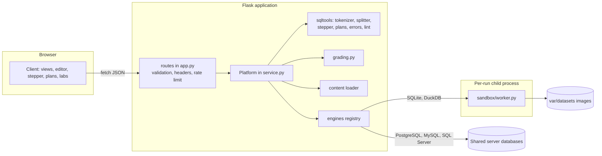
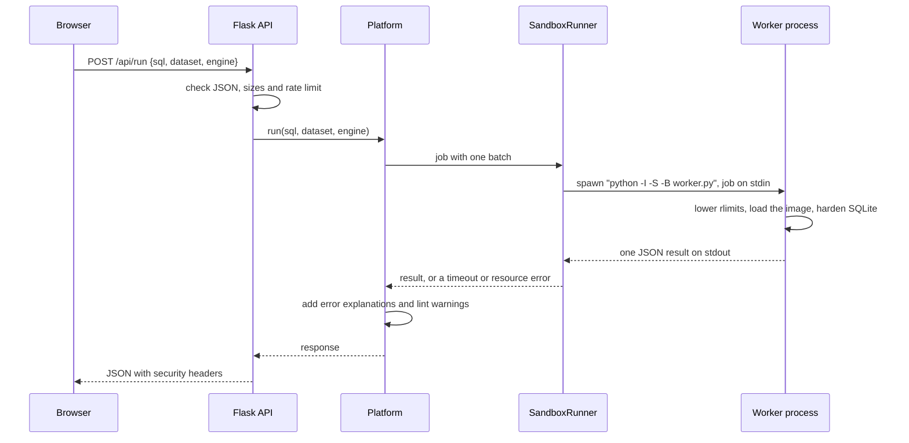

# Architecture

Joinery is a Flask application that serves a JSON API and a static TypeScript client. The API hands SQL to pluggable engines; the embedded engines run it in a short-lived sandbox process. Everything the learner sees (results, stages, plans, grades) is built from one primitive: an engine executing *batches* of statements.

## System overview

## A run, end to end

## Batches: one primitive for every feature

A job contains one or more batches. A batch is a script (split into statements) or a single statement, and can ask for `EXPLAIN` output instead of execution. Batches in a job share one private database, so later batches see earlier changes.

| Feature | Batches |
|---|---|
| Run | the learner's script |
| Explain | optional setup (for example `CREATE INDEX`), then the statement with `explain` and `analyze` |
| Step through | one batch per stage query, plus count queries for filter stages |
| Exercise, result mode | the learner's script; the last statement that returned rows is compared |
| Exercise, state mode | the learner's script, then a verification query whose result is compared |
| Exercise with a plan check | the setup statements, then `EXPLAIN QUERY PLAN` of the final query |

Reference results for exercises are computed once per engine and cached.

## The stepper

`sqltools/stepper.py` tokenizes a SELECT, finds its top-level clauses (ignoring anything inside parentheses, strings or comments) and rewrites it into one real query per stage of the logical processing order. For filter stages it evaluates the condition as a column, `CASE WHEN (condition) THEN 1 ELSE 0 END AS __kept`, so the client can highlight kept rows and strike removed ones. NULL counts as removed, exactly as `WHERE` treats it. GROUP BY ordinals and select-list aliases are resolved, join stages label columns as `alias.column`, CTEs and compound queries get their own stages, and UPDATE and DELETE get a preview of the rows they touch. Queries the stepper cannot decompose are reported as unsupported with a reason. Security never depends on this rewriting: every stage runs in the same sandbox.

## Plans

SQLite reports a logical plan (`EXPLAIN QUERY PLAN`) and the bytecode program it runs (`EXPLAIN`). `sqltools/plans.py` turns the first into a tree, resolves aliases back to tables, classifies each node (full scan, index search, temporary B-tree, correlated subquery and so on) and derives advice. A full scan inside a join loop or an automatic index, for example, suggests the index to create. The bytecode is annotated with what each opcode does, and backward jumps are marked as loops. PostgreSQL JSON plans are normalized into the same node shape. The progress handler that enforces the deadline also counts virtual machine steps, which Joinery reports as a work metric that grows with the data, steadier than milliseconds on small tables.

## The client

The client is TypeScript with no runtime dependencies, bundled by esbuild. A small hyperscript helper (`lib/dom.ts`) builds the DOM, components are plain functions returning elements, and routing uses the URL hash, so the client works from any static host. The editor is a real `<textarea>` layered over a highlighted mirror, which keeps native selection, undo, input methods and screen-reader support. Markdown is rendered on the server with raw HTML disabled; the client inserts it as HTML only in lesson prose.

## Content

Lessons are YAML files validated at startup: unknown datasets, engines, widgets, check modes or duplicate IDs stop the server with a clear message. `python -m joinery validate` runs every example and grades every exercise, both the reference solution (must pass) and the starter code (must not), so broken content fails CI.

## Design decisions

| Decision | Why |
|---|---|
| Server-side sandbox rather than SQLite compiled to WebAssembly | One architecture for all five engines, real engine versions, and plans and grading that the server can verify |
| A new process per run | Perfect isolation between learners and a hard kill switch; it costs about 35 ms |
| Standard-library worker | It can start with `python -I -S` and its attack surface is small and auditable |
| No client framework | No runtime supply chain, a small bundle (about 65 KB), and code any web developer can read |
| YAML content with server-rendered Markdown | Lessons are reviewable in pull requests and validated like code |
