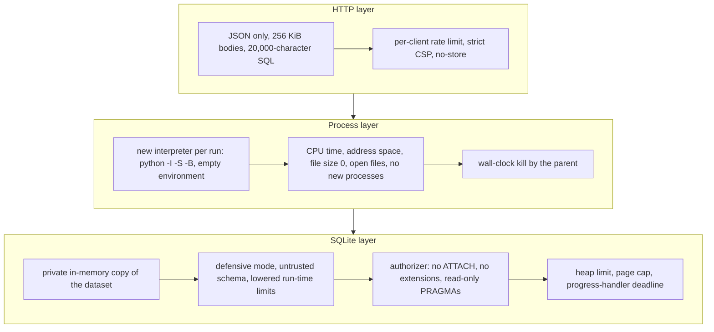

# Security

Joinery executes SQL typed by anyone who can reach it. This document describes what is protected, how, and what remains your responsibility when you deploy it. To report a vulnerability, see [SECURITY.md](../SECURITY.md).

## Threat model

| Asset | Threat | Protection |
|---|---|---|
| The host | Reading or writing files, running programs, opening network connections from SQL | Process sandbox, authorizer, no extension loading, file size limit of zero |
| Availability | Runaway queries, memory or disk exhaustion, request floods | Deadlines, CPU and memory limits, page cap, concurrency cap, rate limiting |
| Other learners | Seeing or changing another person's data | A private, throwaway copy of the dataset per run |
| The sample data | Permanent changes on shared server engines | Transactions that are always rolled back, a statement guard, a low-privilege role |
| Visitors' browsers | Script injection through results or content | Results inserted as text, Markdown rendered without raw HTML, strict CSP |

## Layers for SQLite and DuckDB runs

**Process.** `SandboxRunner` starts `python -I -S -B worker.py` for every job, with an empty environment and `/` as the working directory, so nothing from the server process (secrets in environment variables, open connections, memory) is reachable. A semaphore caps concurrent workers, and the parent kills a worker that outlives its deadline plus a grace period.

**Operating-system limits.** Before reading any SQL, the worker sets `RLIMIT_CPU`, `RLIMIT_AS` (512 MiB), `RLIMIT_FSIZE` (zero: any file write fails), `RLIMIT_NOFILE`, `RLIMIT_CORE` and `RLIMIT_NPROC` (no new processes). `SIGXFSZ` is ignored so a write attempt fails cleanly instead of killing the worker.

**SQLite hardening**, following SQLite's guidance for untrusted input:

- the dataset is deserialized into `:memory:`; there is no database file to tamper with
- `SQLITE_DBCONFIG_DEFENSIVE` on, `TRUSTED_SCHEMA` off, extension loading off, writable schema off
- double-quoted string literals disabled, so `"text"` is always an identifier, as the standard requires
- run-time limits: 1 MB values, 100 KB statements, 200 columns, expression depth 200, 50 compound terms, no attached databases
- `PRAGMA hard_heap_limit` (192 MiB), `PRAGMA max_page_count` (the dataset plus 32 MiB), `temp_store = MEMORY`, `mmap_size = 0`
- an authorizer that denies `ATTACH`, `DETACH` (which also blocks `VACUUM INTO`), `load_extension`, `fts3_tokenizer` and every `PRAGMA` outside an allowlist of read-only introspection pragmas and a few harmless toggles
- a progress handler that aborts any statement once the run's deadline passes

**DuckDB** runs in the same process sandbox with `enable_external_access = false`, extension autoloading and autoinstalling disabled, one thread, a memory limit and `lock_configuration = true`, following DuckDB's guide to securing untrusted SQL.

## Server engines

PostgreSQL, MySQL and SQL Server keep the datasets in a shared database, so isolation comes from the database itself:

- Joinery connects as `joinery_sandbox`, which can only read and write the dataset tables (plus create objects in the PostgreSQL dataset schemas, which are rolled back).
- Every run is one transaction with statement and lock timeouts, and it is **always rolled back**.
- Each statement runs inside a savepoint, so errors do not leak state between statements.
- A lexical guard refuses statements that could end the transaction or change the server: `COMMIT`, `ROLLBACK` (except to a savepoint), `SET ROLE`, `GRANT`, `COPY`, `DO`, dynamic SQL, file functions, and on MySQL any DDL other than temporary tables, because MySQL commits DDL implicitly.

The guard is defense in depth; the role's privileges are the real boundary. Treat these engines as experimental until the engines workflow is green, and give them a dedicated, disposable database server.

## HTTP

- Content Security Policy `default-src 'self'` with no inline scripts or styles; fonts from Google Fonts only when web fonts are enabled
- `X-Frame-Options: DENY`, `frame-ancestors 'none'`, `nosniff`, `no-referrer`, COOP and CORP same-origin, a restrictive `Permissions-Policy`
- JSON request bodies only, at most 256 KiB, SQL at most 20,000 characters by default; API responses are `Cache-Control: no-store`
- a per-client sliding-window rate limit on POST requests (120 per minute by default)
- no cookies, sessions or accounts: progress lives in the learner's browser

## What the tests check

`tests/test_sandbox.py` attempts each escape and abuse case against the real worker: attaching databases and system files, `VACUUM INTO` writing a file (it is refused and no file appears), dangerous pragmas, extension loading, infinite recursion (stopped by the deadline), half-gigabyte allocations, unbounded table growth and memory exhaustion. It also checks that the server's environment never reaches the worker. `tests/test_guard.py` covers the server-engine guard and `tests/test_platform.py` covers headers, input validation and rate limiting.

## Your responsibilities when deploying

- Run the container as provided: read-only root filesystem, non-root user, `no-new-privileges`, all capabilities dropped, and memory, CPU and PID limits.
- Put a TLS-terminating reverse proxy in front and enable `JOINERY_TRUST_PROXY` only behind it. The built-in rate limiter is per process; add a shared limit at the proxy for multi-process deployments.
- Never point a server engine at a database that holds anything but the sample data.
- Keep dependencies current: Dependabot, `make audit` and CodeQL are configured.

SQLite and DuckDB both state that SQL from untrusted sources should only run with sandboxing. Joinery layers OS-level limits under the engines' own controls, but no sandbox is perfect. For a public deployment, also consider running the container under gVisor or another hardened runtime.
